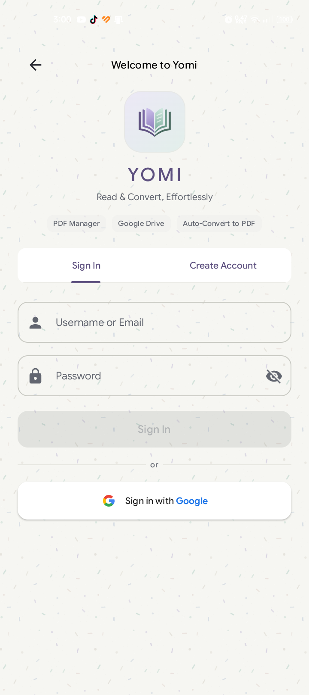
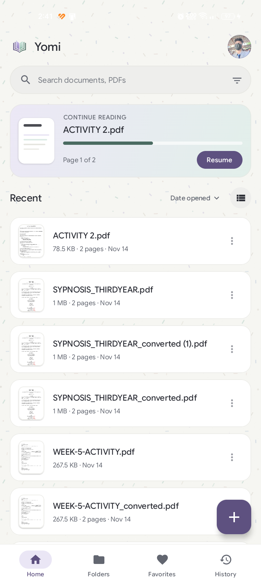
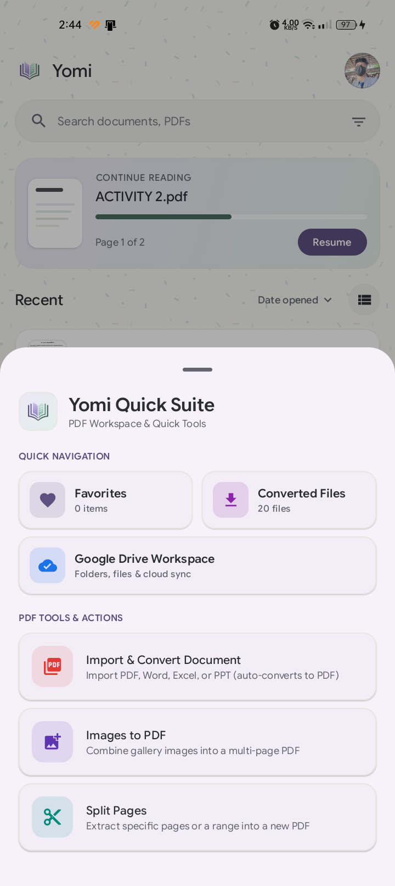

# Yomi — Smart Android PDF Reader & Offline-First Document Suite

**Yomi** is a modern Android PDF reader and document workspace built with **Kotlin** and **Jetpack Compose (Material 3)**. It combines a smooth multi-mode PDF viewer with an **Offline-First Office-to-PDF conversion engine** (Word, Excel, PowerPoint, Text, and Images), built-in PDF tools (Merge, Split, Images-to-PDF, Annotations), and a read-safe **Google Drive Workspace**.

---

## Screenshots

### Authentication & Workspace

<table>
  <tr>
    <td align="center">
      <br />
      <b>Sign In</b><br />
      <sub>Local account or Google Sign-In</sub>
    </td>
    <td align="center">
      <br />
      <b>Create Account</b><br />
      <sub>Instant account setup & password validation</sub>
    </td>
    <td align="center">
      <br />
      <b>Home Dashboard</b><br />
      <sub>Continue Reading card, search & recents</sub>
    </td>
  </tr>
</table>

### Folders, Quick Suite, PDF Reader & Updates

<table>
  <tr>
    <td align="center">
      <br />
      <b>Folders & Drive Workspace</b><br />
      <sub>Custom folders & read-safe Drive sync</sub>
    </td>
    <td align="center">
      <br />
      <b>Yomi Quick Suite</b><br />
      <sub>Quick navigation & built-in PDF tools</sub>
    </td>
    <td align="center">
      <br />
      <b>Multi-Mode PDF Reader</b><br />
      <sub>Thumbnails, zoom presets & annotations</sub>
    </td>
    <td align="center">
      <br />
      <b>About Yomi & Updates</b><br />
      <sub>Built-in updater, FAQ & credits</sub>
    </td>
  </tr>
</table>

---

## Key Features

- **Multi-Mode PDF Reader**
  - Switch between **Continuous Scroll**, **Single-Page**, and **2-Page Book Spread** layouts.
  - Interactive **Page Thumbnails Grid**, **Zoom Presets** (`Fit Width`, `Fit Page`, `100%–200%`), **90° Rotation**, **Fullscreen Reading**, and **Full-Text Search** with highlighted matches.
  - **Freehand Ink, Highlights & Sticky Notes**: Annotate any page and export flattened annotated PDFs.
- **Offline-First Office & Image to PDF Engine**
  - Converts `.docx`, `.doc`, `.xlsx`, `.xls`, `.pptx`, `.ppt`, `.txt`, and images to PDF directly on-device using Apache POI & Android `PdfDocument` (0 cloud credits required).
  - Automatic **Cloudflare Worker Middleman Proxy** failover (`iLovePDF` + `CloudConvert`) when online if an offline conversion fails, keeping all API keys strictly on the server and out of the APK.
- **Yomi Quick Suite (Built-In PDF Tools)**
  - **Images to PDF**: Combine gallery images into a multi-page PDF with automatic EXIF orientation and downsampling.
  - **Split Pages**: Extract specific pages or page ranges (`1-3, 5`) into a new PDF.
  - **Merge PDFs**: Combine multiple PDF documents into a single file.
- **Read-Safe Google Drive Workspace**
  - Link a Google Drive folder or shared link to browse and convert cloud documents without modifying or deleting files in your Drive.
- **Adaptive Themes**
  - Light, Dark, and Sepia reading modes with customizable accent palettes.

---

## Tech Stack

- **Language & UI**: Kotlin, Jetpack Compose, Material 3
- **PDF Rendering & Tools**: Android `PdfRenderer`, `PdfDocument`, custom bounded bitmap LRU cache
- **Offline Office Parsing**: Apache POI (`poi`, `poi-ooxml`)
- **Cloud Conversion Proxy**: Cloudflare Workers (`backend/cloudflare-worker`)
- **Auth & Cloud**: Google Credential Manager (`androidx.credentials`), Google Drive REST API v3
- **Background Work**: AndroidX WorkManager (`StorageScannerWorker`)

---

## Building from Source

1. Clone the repository:
   ```bash
   git clone https://github.com/jooossshhhhh/yomiapp.git
   cd yomiapp
   ```
2. Build the Debug APK (works out of the box with the on-device Offline Engine):
   ```bash
   ./gradlew assembleDebug
   ```
3. *(Optional)* To enable the Cloudflare Worker cloud backup proxy, add your Worker URL to `local.properties`:
   ```properties
   conversion.proxy.url=https://yomi-conversion-proxy.<your-subdomain>.workers.dev
   ```

---

## Credits

- **Developer**: Jude Lawrence L. Sinugbuhan
- **Product & UX Advisors**: Mark June Repunte & Jherico Maurin

