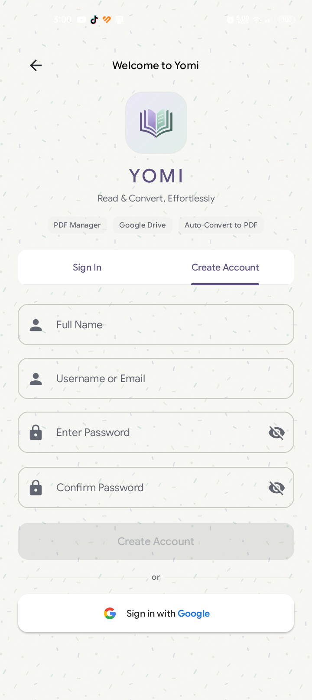
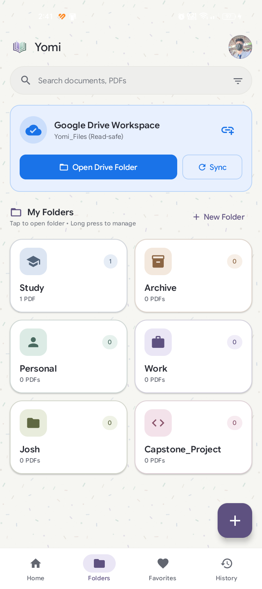
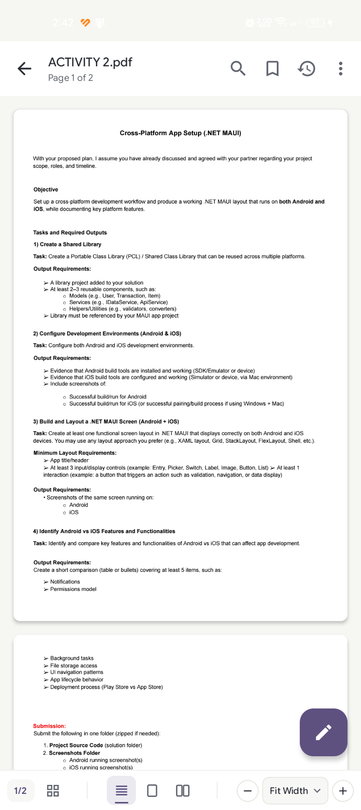
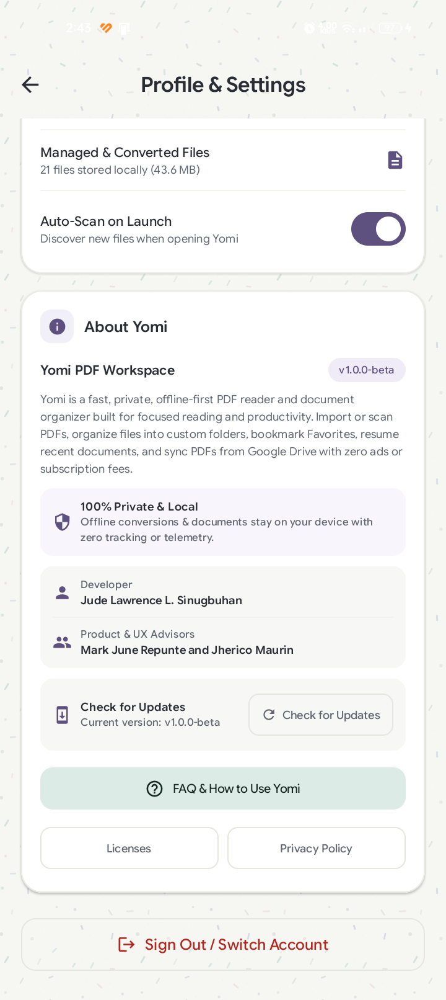

# Yomi — Smart Android PDF Reader & Offline-First Document Suite

**Yomi** is a modern Android PDF reader and document workspace built with **Kotlin** and **Jetpack Compose (Material 3)**. It combines a smooth multi-mode PDF viewer with an **Offline-First Office-to-PDF conversion engine** (Word, Excel, PowerPoint, Text, and Images), built-in PDF tools (Merge, Split, Images-to-PDF, Annotations), and a read-safe **Google Drive Workspace**.

---

## Screenshots

### Authentication & Workspace

<table>
  <tr>
    <td align="center">
      <br />
      <b>Sign In</b><br />
      <sub>Local account or Google Sign-In</sub>
    </td>
    <td align="center">
      <br />
      <b>Create Account</b><br />
      <sub>Instant account setup & password validation</sub>
    </td>
    <td align="center">
      <br />
      <b>Home Dashboard</b><br />
      <sub>Continue Reading card, search & recents</sub>
    </td>
  </tr>
</table>

### Folders, Quick Suite, PDF Reader & Updates

<table>
  <tr>
    <td align="center">
      <br />
      <b>Folders & Drive Workspace</b><br />
      <sub>Custom folders & read-safe Drive sync</sub>
    </td>
    <td align="center">
      <br />
      <b>Yomi Quick Suite</b><br />
      <sub>Quick navigation & built-in PDF tools</sub>
    </td>
    <td align="center">
      <br />
      <b>Multi-Mode PDF Reader</b><br />
      <sub>Thumbnails, zoom presets & annotations</sub>
    </td>
    <td align="center">
      <br />
      <b>About Yomi & Updates</b><br />
      <sub>Built-in updater, FAQ & credits</sub>
    </td>
  </tr>
</table>

---

## Key Features

- **Multi-Mode PDF Reader**
  - Switch between **Continuous Scroll**, **Single-Page**, and **2-Page Book Spread** layouts.
  - Interactive **Page Thumbnails Grid**, **Zoom Presets** (`Fit Width`, `Fit Page`, `50%–200%`), **90° Rotation**, **Fullscreen Reading**, and **Full-Text Search** with highlighted matches.
  - **Freehand Ink, Highlights & Sticky Notes**: Annotate any page and export flattened annotated PDFs.
- **100% On-Device Office & Image-to-PDF Engine (LibreOfficeKit)**
  - Converts `.docx`, `.doc`, `.xlsx`, `.xls`, `.pptx`, `.ppt`, `.rtf`, `.odt`, `.ods`, `.odp`, `.csv`, `.txt`, and images (`.jpg`, `.png`, `.webp`) directly on-device with zero internet dependency, cloud uploads, or API quotas.
  - Runs the native **LibreOfficeKit (`arm64-v8a`)** engine inside an isolated `:converter` background process (`LibreOfficeConversionService`) paired with bundled fonts and OOXML preprocessors:
    - **`DocxPreProcessor`**: Relaxes `exact` textbox/table-row/line-height clipping constraints (preserving 1pt spacers), merges layered anchored figures/insets cleanly, clamps off-page anchor coordinates, fixes hidden borders/floating tables, and handles `ZipFile` streaming reliably.
    - **`XlsxPreProcessor`**: Strips manual page breaks and scales each worksheet cleanly onto a single A4 page (portrait or landscape based on sheet dimensions).
- **Yomi Quick Suite (Built-In PDF Tools)**
  - **Images to PDF**: Combine gallery images into a multi-page PDF with automatic EXIF orientation and downsampling.
  - **Split Pages**: Extract specific pages or page ranges (`1-3, 5`) into a new PDF.
  - **Merge PDFs**: Combine multiple PDF documents into a single file.
- **Offline-Ready Read-Safe Google Drive Workspace**
  - Link a Google Drive folder or shared link to browse and convert cloud documents without modifying or deleting files in your Drive.
  - Caches supported files locally for **`Offline ready`** viewing/conversion, provides hideable `0%–100%` sync progress, filters out temporary Office lock clutter (`~$*`), alerts via a **"Folder Sync Not Finished"** modal if internet drops mid-sync, and frees cache automatically on unlink while preserving converted PDFs.
- **Built-In In-App Updater & FAQ**
  - Checks GitHub Releases automatically or from **Profile & Settings → About Yomi** with one-tap **Update Now** APK downloads and an updated interactive **FAQ & User Guide**.
- **Adaptive Themes**
  - Light, Dark, and Sepia reading modes with customizable accent palettes.

---

## Tech Stack

- **Language & UI**: Kotlin `2.2.10`, Jetpack Compose, Material 3 (Android Gradle Plugin `9.4.1`, `minSdk 26`, `targetSdk 37`)
- **PDF Rendering & Tools**: Android `PdfRenderer`, `PdfDocument`, custom bounded bitmap/thumbnail cache
- **Offline Office Engine**: Bundled native **LibreOfficeKit (`arm64-v8a`)** in isolated `:converter` service + OOXML `DocxPreProcessor` & `XlsxPreProcessor`
- **Local Storage & Indexing**: Native Android `SQLiteOpenHelper` (`YomiDatabase`), `SharedPreferences` (`PreferencesManager`), AndroidX `WorkManager` (`StorageScannerWorker`)
- **Auth & Cloud**: Google Credential Manager (`androidx.credentials` + `googleid`), `AccountManager` (`drive.file` OAuth2), Google Drive REST API v3 / public shared link client
- **Image Loading**: Coil Compose `2.7.0`

---

## Building from Source

1. Clone the repository:
   ```bash
   git clone https://github.com/jooossshhhhh/yomiapp.git
   cd yomiapp
   ```
2. Build the Debug APK (bundles LibreOfficeKit `arm64-v8a` offline conversion out of the box):
   ```bash
   ./gradlew assembleDebug
   ```
3. Run JVM unit tests:
   ```bash
   ./gradlew :app:testDebugUnitTest
   ```
4. Build the signed Release APK (configure `release.store.file`, `release.store.password`, `release.key.alias`, and `release.key.password` in git-ignored `local.properties`):
   ```bash
   ./gradlew :app:assembleRelease
   ```
   Signed builds are archived locally in [Apk Releases/](Apk%20Releases/README.md) (`yomi-v1.0.6-release.apk`).

---

## Credits

- **Developer**: Jude Lawrence L. Sinugbuhan
- **Product & UX Advisors**: Mark June Repunte & Jherico Maurin

